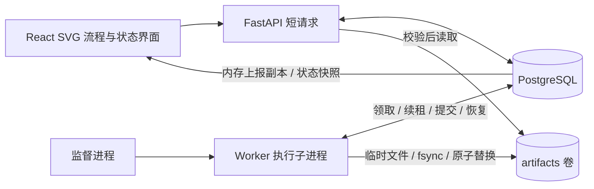
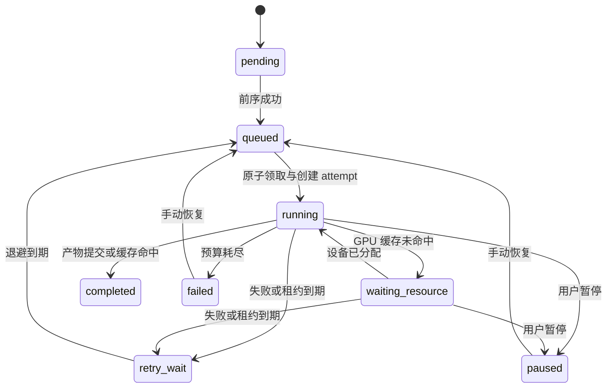

# 动画素材长任务管线设计

## 实现范围

保持 PostgreSQL 为唯一业务状态源。API 负责提交与查询，独立 Worker 执行六个有序步骤；每个任务同一时刻只执行一个步骤，不同任务并行。GPU 算法、显存和耗时使用 MOCK，磁盘文件、事务、重试、排队、子进程退出与检查点恢复均真实运行。页面中的原创 SVG 狐狸展示导入、抽帧、去背景、变色、合成与动画导出。

本项目采用至少一次执行语义。令牌阻止过期尝试更新当前状态；确定性产物和校验使重复计算可安全收敛。对于真实模型 API、计费、上传和发布等外部副作用，还需要下游幂等键，不能据此宣称 exactly-once。

监督进程只启动/观察执行子进程，从数据库读取 `desired_state`。它不保存任务队列、进度或检查点。执行子进程拥有最多 3 个执行线程；进程退出后内存对象全部丢失。新的执行子进程必须重新从数据库领取工作。

## 持久模型与状态

| 表 | 数据与职责 |
| --- | --- |
| `tasks` | 名称、状态、起止时间、素材标识、参数、版本、缓存策略 |
| `steps` | 顺序、CPU/GPU 需求、状态、已提交进度、检查点引用、重试预算、下次重试时间、缓存指纹 |
| `step_attempts` | 每次领取的一条记录，递增编号、Worker、随机 owner token、心跳、租约、恢复起点、错误与有限检查点日志 |
| `status_events` | 追加式转换与检查点历史，数据库自增序号、任务/步骤关联、时间与上下文 |
| `artifacts` | 文件引用、SHA-256、大小、缓存键、来源步骤；文件内容放在产物卷 |
| `resource_allocations` | 每次 GPU 请求的排队、分配、释放与所属 attempt |
| `gpu_devices` | 设备型号、容量、唯一当前占用 attempt；初始 1 个 MOCK GPU，8 GB |
| `workers` | 进程启动标识、PID、期望状态、心跳、并发数、内存遥测副本 |

任务状态：`pending → running → completed`；执行中的步骤耗尽重试则任务 `failed`。主动暂停为 `paused`，手动恢复为 `running`。`completed`、`cancelled` 是终态，API 拒绝对其恢复。失败和暂停不是终态。

图中省略了取消与尚未开始步骤的暂停边：取消把未完成步骤标为 `skipped`，运行中的 attempt 标为 `interrupted`。所有未成功步骤都可以暂停；恢复时仅依赖已满足的第一个步骤就绪。

尝试状态为 `running → succeeded / failed / interrupted`。恢复和手动重试创建新 attempt，不覆盖旧记录。`max_retries=3` 表示初次执行之外最多 3 次自动重试；故障和租约失效共用预算。第 4 次失败进入 `failed`，手动恢复重新给予本轮预算，编号和历史持续递增。

任务与步骤状态转换、尝试更新、资源释放和事件均在同一个短事务内提交。事件的 `sequence` 提供稳定排序（允许序号空洞），不依赖同一事务内可能相同的时间戳。事件 API 倒序游标分页；页面默认最近 100 条并可加载更早记录。

## 领取、租约与恢复

1. Worker 按创建时间检查活动任务，用 `FOR UPDATE SKIP LOCKED` 锁任务行，保证同一任务只有一个领取者。验证前序步骤完成，再在同一事务中把步骤设为运行并创建 attempt、令牌和租约。事务提交后才开始计算。
2. 所有状态写入按 `task → step/attempt → device` 的顺序持锁。每次心跳、检查点、资源分配、失败和结果提交都验证：任务允许执行、步骤仍活动、attempt 仍运行、owner token 一致、数据库时间早于租约到期。
3. 默认租约为 10 秒。MOCK 每个工作单元内部每约 0.4 秒检查控制与续租；即使一个工作单元耗时数分钟，仍持续心跳。
4. 每轮轮询扫描过期租约，而非仅启动时扫描。扫描进程锁任务行，再次确认到期，把旧 attempt 标为 `interrupted`、释放 GPU、记录事件并进入退避。活跃 Worker 重启早于旧租约到期时，会继续轮询至到期。
5. 新 attempt 恢复前校验检查点文件摘要及缓存键。损坏或版本不匹配则当前步骤从头计算。旧进程即使恢复联网也无法续租或提交。

PostgreSQL 官方将 `SKIP LOCKED` 列为队列类多消费者避让锁竞争的适用方式，本项目在此基础上实现业务租约与恢复规则：[SELECT 锁定子句](https://www.postgresql.org/docs/16/sql-select.html)。它本身不提供任务重试或工作流状态机。

MVP 锁任务行后遍历串行步骤，适合小规模演示。大规模部署需要更有针对性的候选查询、分批回收、必要索引和公平队列，避免一次领取扫描并锁住过多任务。

## 检查点、文件与缓存

每个 MOCK 步骤包含 20 个工作单元，每完成 4 个单元，先将帧索引清单写入唯一检查点文件，计算 SHA-256，再提交数据库检查点引用。显示的内存进度可以领先数据库；进程崩溃只恢复到最后一次持久化进度，未提交的缓冲需要重算。检查点是 MOCK 工作清单，真实逐帧模型须保存可重新加载的输出分片、随机状态等。

结果指纹：`SHA256(管线/算法版本 + 步骤名 + 上游产物摘要 + 影响该步骤的参数)`。首步输入为内置素材标识的摘要。素材内容变更须更新素材标识或版本；接入上传后应直接对输入文件内容求摘要。风格参数从风格迁移步骤开始进入指纹，任务名称、耗时倍率和故障注入不影响计算结果，因此不参与缓存键。

缓存不是 `completed` 标记的别名。只有通过文件存在性和 SHA-256 校验的产物才可复用；命中记录 `reused_from` 并创建本次产物引用，GPU 步骤在缓存检查后才申请资源。关闭跨任务复用时仍允许同一步骤的后续尝试接管已落盘的确定性输出。

最终 SVG 输出由输入、步骤、版本、参数确定，先写唯一临时文件，`fsync` 后原子替换到 `results/{cache_key}.svg`；Linux 下同步父目录。数据库最后发布成功与产物引用。输出已落盘但事务未成功时，下次尝试校验确定性文件并记录 `orphan-output`，无需重算。未完成的临时文件和旧检查点不被当成成功产物；MVP 未实现垃圾回收。

执行前检查上游文件；发现缺失或损坏则失败并记录原因。手动恢复会重新校验已经成功的步骤，并使首个损坏产物及依赖它的后续步骤重新就绪。有效前序保留。访问产物接口遇到校验失败返回 409。

## 不同失败场景的结果

| 场景 | 数据库与后续行为 |
| --- | --- |
| 瞬态计算错误 | attempt=`failed`，保留检查点，释放 GPU，按 2/4/8 秒退避重试当前步骤 |
| 持续错误 / GPU OOM 的 MOCK | 有限预算耗尽后 task=`failed`；修正参数或清除演示故障后手动恢复 |
| 用户暂停 | 事务内使执行资格失效，attempt=`interrupted`，task=`paused`，保留检查点；等待手动恢复 |
| 用户取消 | task=`cancelled`，未完成步骤=`skipped`，释放名额；旧执行器禁止提交，不能恢复终态 |
| 执行子进程 SIGKILL / 页面崩溃按钮 | 无清理、无伪造成功；内存消失，数据库暂留 running/占用，租约过期后由活跃 Worker 回收 |
| 全部 Worker 停止 | 任务数据可查询；不会自行恢复，任一 Worker 启动后继续扫描 |
| API 重启 / 浏览器刷新 | Worker 独立运行，刷新后通过快照恢复界面，不丢执行状态 |
| 数据库暂时不可用 | 不提交进度或成功；Worker 重试连接，无法续租的 attempt 到期后重新领取；可能重算未提交工作 |
| 文件已发布、DB 提交前退出 | 确定性文件校验通过后接管，历史记录来源为孤立输出 |
| 检查点文件损坏 | 当前步骤从头执行，写 `checkpoint_invalid`，此前成功步骤保留 |
| 缓存或已成功输入文件损坏 | 拒绝缓存/读取；重新计算或在手动恢复时失效对应依赖链 |
| 老 Worker 延迟回写 | owner token / attempt / 状态 / 租约检查拒绝；不会覆盖新尝试或取消状态 |

API 创建请求目前没有客户端请求幂等键；请求超时后重新提交可能创建两个任务，但其步骤可复用结果。生产接入应增加提交级 idempotency key。

## GPU 调度与可观测性

GPU 步骤声明 1 个独占名额、4096 MB 显存需求。默认设备 `gpu-0` 容量 8192 MB，一次只允许一个 attempt 占用整卡；剩余显存不意味着可以再分配。请求以入队时间/ID 顺序检查，锁设备行并验证空闲后才分配，等待期间仍续租。MOCK 模型加载 1.2 秒，状态 `waiting → allocating → allocated → released` 可查询。

页面展示全局队列、任务与步骤、排队秒数、设备 ID、显存预留、Worker/PID/启动标识、心跳、内存工作单元及历史。动态连接线和数据包由实际队列/运行状态驱动。没有硬件采样，所以不展示虚假的 GPU 利用率、温度或真实显存用量。

数据库里的 `workers.runtime` 是工作内存的遥测副本，不能作为恢复依据。副本超过 3 秒或执行进程离线时标为不可用；监督进程确认退出才清空快照。`snapshot` 用 PostgreSQL REPEATABLE READ 返回一致的数据库读视图，内存遥测本身仍有上报延迟。页面约 0.7 秒串行轮询，网络错误明确显示，避免旧请求覆盖新选择。

本地设备表适用于共享资源池的 MOCK。接入真实 GPU 时需增加节点归属、显卡 UUID/型号、显存与模型兼容标签；仅让所在节点 Worker 领取该设备，设置 CUDA 可见设备并使用进程或容器隔离。真实取消必须确认执行进程/内核已停止再释放硬件，租约 fencing 本身不会终止 GPU 内核。

## 为什么这样划分 AI 步骤

| 独立步骤 | 输入 → 可恢复输出 | 适合作为边界的原因 |
| --- | --- | --- |
| 素材导入 / 校验 | 固定素材 → 规范化素材与摘要 | 尽早隔离输入问题，形成稳定的后续依赖 |
| 帧提取 / 预处理（CPU） | 素材 → 帧序列与时间戳 | 不依赖 GPU，跨模型/风格复用；按帧批次续跑 |
| 背景移除（GPU） | 帧 → 前景、mask | 昂贵独立推理，可按帧或镜头存储；与风格解耦 |
| 风格迁移 / 关键帧生成（GPU） | 前景、参数 → 风格化关键帧 | 模型版本、提示词、seed 影响输出，单独缓存和重试 |
| 帧合成（CPU） | 处理帧、时间戳 → 合成帧/清单 | 不需要占住 GPU，失败不应重算上游推理 |
| 动画导出（CPU） | 合成帧 → 最终产物 | 文件发布作为独立可验证边界；真实编码可按片段后合并 |

后续插帧/超分可分别添加 GPU 步骤，按镜头或帧区间生成独立分片后汇合。每个轻量数据转换函数无需成为持久任务；边界应具有高重算成本、可序列化输入输出和有意义的检查点。扩展到 DAG 时将隐含 `order-1` 依赖替换为显式边表与 join 规则。

## 从秒级扩展到小时级

| 方面 | 当前 MVP | 小时级真实计算的演进 |
| --- | --- | --- |
| 请求生命周期 | 提交后立即返回，由 Worker 执行 | 保持短请求，加入请求幂等键与任务配额 |
| 检查点 | 20 单元、每 4 单元提交 | 按帧/镜头分片，按时间或计算成本周期提交，兼顾 IO 与最大重算成本 |
| 心跳与执行 | MOCK 内循环约 0.4s 续租 | 独立心跳通道/线程或父进程，和阻塞 CUDA/模型请求解耦；例如心跳 5s、租约 30s，再按网络情况调整 |
| 超时 | 有限重试，没有硬执行截止时间 | 分离排队、单次执行、无进展与任务总截止时间；心跳活跃但卡死也要检测 |
| GPU | 单名额、4096 MB 需求、MOCK 装载 | 分资源队列、节点亲和、优先级与防饥饿、模型预热、显存准入、OOM 分类；需要时再考虑 MIG/抢占 |
| 存储 | 本机共享卷、SVG 与小型清单 | 对象存储、不可变分片 manifest、断点上传、保留策略与可达性垃圾回收 |
| 并发与隔离 | 3 线程，等待 GPU 也占执行线程 | 将等待队列与执行名额分离，CPU/GPU 池隔离；真实任务用子进程/容器杀死与回收 |
| 数据库成本 | 高频进度/心跳便于演示 | 降频与批量上报，任务/事件分区和归档，索引到期扫描、用 LISTEN/NOTIFY 辅助唤醒 |
| 可观测性 | 状态、事件、原始快照与基础 metrics | OTel trace 串联任务/步骤/尝试，Prometheus 记录延迟/失败率/队列年龄，DCGM 采真实 GPU 指标 |
| 运行控制 | 有限重试、暂停、取消、进程重启 | 优雅排空、版本固定、失败分类、退避抖动、死信与人工排障、租户权限和审计 |

小时级运行不需要把事务保持小时级。当前长任务选项只拉长 MOCK 工作单元，验证续租与持久状态可以持续存在；未实现上述生产调度和硬件隔离能力。

## 验收证据

`backend/tests/test_pipeline.py` 使用真正 PostgreSQL 行锁和事务，覆盖并发领取、依赖、重试、fencing、GPU 名额、缓存/检查点损坏、终态和子进程崩溃。真实子进程测试检查 PID 改变、旧 attempt 中断、恢复起点大于零。前端 `npm run build` 检查 TypeScript 与生产打包。手工演示操作路径见 README。
